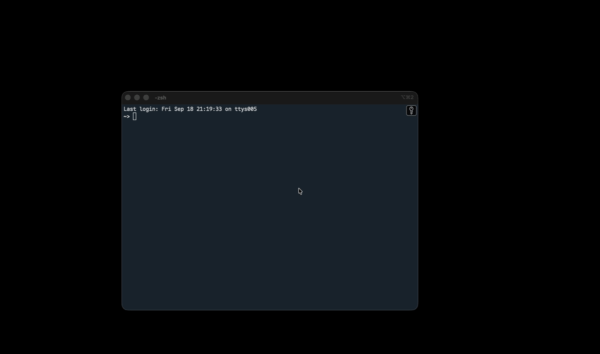

# GridSnap

An open source alternative to [Divvy](https://mizage.com/divvy/) for macOS. Press a shortcut, a grid appears, drag across the cells you want, and the window snaps there. Save a region as a preset and it becomes a one-keystroke snap.



- Grid overlay with live preview: the window follows your drag and jumps back if you cancel
- Presets with their own global shortcuts; a Full screen preset on ⌃⌥F comes built in
- Undo the last snap
- Configurable grid size and gap between windows
- Snap the focused window or the one under the cursor
- A grid on every display: snap to any display's grid to move the window there
- The app the window belongs to, icon and name, above every grid
- Menu bar app, launch at login, no Dock icon
- No network access, no analytics, no accounts

## Requirements

- macOS 14 or later. Tested on macOS 26; on older versions the grid gets a frosted panel instead of the glass material.
- Apple Silicon or Intel.
- To build: Xcode Command Line Tools with the macOS 26 SDK. No Xcode project, `swiftc` compiles the files directly.

## Install

With Homebrew:

```sh
brew install --cask konieczkow/tap/gridsnap
```

Or download `GridSnap-x.y.z.zip` from the [latest release](https://github.com/konieczkow/gridsnap/releases/latest), unzip it and drag GridSnap to Applications.

On first launch GridSnap asks for **Accessibility**, which it needs to move other apps' windows. Turn it on under System Settings › Privacy & Security › Accessibility (the menu bar icon has a **Grant Accessibility…** item that opens that pane). GridSnap picks the grant up on its own, no relaunch needed.

Or build it yourself:

```sh
git clone https://github.com/konieczkow/gridsnap.git
cd gridsnap
./build.sh install
open /Applications/GridSnap.app
```

## Use

| Action | How |
|---|---|
| Show the grid | ⌃⌥D (change it in Settings) |
| Snap | Click or drag cells and release, or press Return |
| Move the selection | Arrow keys |
| Grow or shrink it | Shift+→ / Shift+↑ grow, Shift+← / Shift+↓ shrink |
| Use another display's grid | Click it, or press Tab |
| Cancel | Esc, or drag onto the app header or outside the panel and release |
| Dismiss | Click anywhere outside the grid |
| Save a preset | Hold Shift when releasing or pressing Return, or use **+** in Settings |
| Apply a preset | Its shortcut, or the Presets menu |
| Undo last snap | ⌃⌥Z by default, press again to redo |

The grid opens with the window's current cells outlined, so Return alone aligns it to the grid.

With more than one display, a grid appears on each of them. Select cells on any display's grid and the window snaps to that display, so a drag on the other monitor's grid moves the window there. The keyboard starts on the grid for the display the window is on; Tab moves the selection, and the window with it, to the next display. A preset's shortcut snaps to the display the window is already on.

Wider gutters in the grid mark halves, thirds and quarters.

**Settings** (menu bar icon › Settings…) holds both shortcuts, columns and rows, the gap in points between snapped windows, the target rule, and the presets table. Names and shortcuts are editable in place; **−** removes the selected preset.

## Development

```sh
./build.sh            # builds build/GridSnap.app
./build.sh install    # also copies it to /Applications
```

`Resources/icon.png` is the icon source; regenerate `AppIcon.icns` from it with `iconutil` if you change it.

Files in `Sources/`: `main.swift` startup, `AX.swift` window plumbing, `Grid.swift` overlay, `Presets.swift`, `Hotkeys.swift`, `ShortcutButton.swift` recorder, `SettingsWindow.swift`, `Menu.swift`, `Defaults.swift` stored settings.

macOS ties the Accessibility grant to the app's code signature. The default ad-hoc signature changes with every build, so you'd re-grant permission after each rebuild. To avoid that, create a self-signed certificate once (Keychain Access › Certificate Assistant › Create a Certificate, type "Code Signing", name it `GridSnap Dev`) and the build script picks it up. Any other identity works via `CODESIGN_IDENTITY="name" ./build.sh`.

## Known limitations

- Full-screen windows ignore snapping.
- Some apps enforce a minimum window size and won't shrink to a small cell. The window then stays on screen and overlaps the neighbouring cells.

## License

MIT, see [LICENSE](LICENSE).
