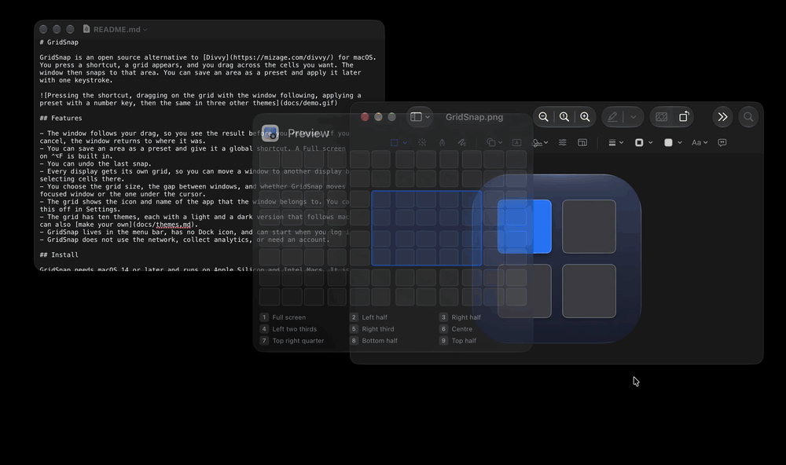

# GridSnap

GridSnap is an open source alternative to [Divvy](https://mizage.com/divvy/) for macOS. You press a shortcut, a grid appears, and you drag across the cells you want. The window then snaps to that area. You can save an area as a preset and apply it later with one keystroke.



## Features

- The window follows your drag, so you see the result before you release. If you cancel, the window returns to where it was.
- You can save an area as a preset and give it a global shortcut. A Full screen preset on ⌃⌥F is built in.
- You can undo the last snap.
- Every display gets its own grid, so you can move a window to another display by selecting cells there.
- You choose the grid size, the gap between windows, and whether GridSnap moves the focused window or the one under the cursor.
- The grid shows the icon and name of the app that the window belongs to. You can turn this off in Settings.
- GridSnap lives in the menu bar, has no Dock icon, and can start when you log in.
- GridSnap does not use the network, collect analytics, or need an account.

## Install

GridSnap needs macOS 14 or later and runs on Apple Silicon and Intel Macs. It is tested on macOS 26, where the grid uses the glass material. On older versions the grid is frosted instead.

Install it with Homebrew:

```sh
brew install --cask konieczkow/tap/gridsnap
```

You can also download `GridSnap-x.y.z.zip` from the [latest release](https://github.com/konieczkow/gridsnap/releases/latest), unzip it, and drag GridSnap to your Applications folder.

When you first open GridSnap, it asks for the **Accessibility** permission, which it needs to move the windows of other apps. Turn the permission on in System Settings › Privacy & Security › Accessibility. The **Grant Accessibility…** item in the GridSnap menu opens that pane for you. GridSnap notices the permission by itself, so you do not need to restart it.

## Use

1. Bring the window you want to move to the front, then press ⌃⌥D (Control-Option-D). A grid panel appears on every display.
2. Drag across the cells you want. The window follows your drag.
3. Release to snap the window. To cancel, press Esc or release outside the panel.

To undo the last snap, press ⌃⌥Z.

[Using GridSnap](docs/usage.md) explains the rest: keyboard control, presets, more than one display, and Settings.

## Build from source

[Building GridSnap](docs/development.md) explains how to build the app and where to find things in the code.

## Known limitations

- GridSnap cannot snap a window that is in full-screen mode.
- Some apps set a minimum window size and will not shrink to a small area. The window then stays on the screen and overlaps the neighbouring cells.

## License

GridSnap is released under the [MIT License](LICENSE).
